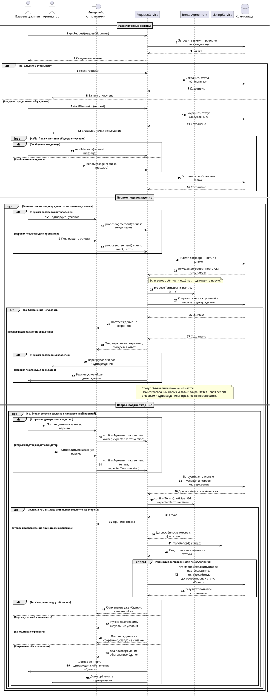

# 03. Обсуждение заявки и подтверждение договорённости об аренде

[Сценарий №03](../Прецеденты/03-Обсуждение-заявки-и-подтверждение-аренды.md) · [Диаграмма классов](../Диаграмма-классов.md)

```plantuml
@startuml
skinparam sequenceMessageAlign center
skinparam maxMessageSize 190
hide footbox
autonumber

actor "Владелец жилья" as Owner
actor "Арендатор" as Tenant
boundary "Интерфейс\nотправителя" as UI
participant RequestService
participant RentalAgreement
participant ListingService
database "Хранилище" as Store

== Рассмотрение заявки ==

Owner -> RequestService: getRequest(requestId, owner)
RequestService -> Store: Загрузить заявку, проверив права владельца
Store --> RequestService: Заявка
RequestService --> Owner: Сведения о заявке
alt 1а. Владелец отказывает
  Owner -> RequestService: reject(request)
  RequestService -> Store: Сохранить статус «Отклонена»
  Store --> RequestService: Сохранено
  RequestService ->> Tenant: Заявка отклонена
else Владелец продолжает обсуждение
  Owner -> RequestService: startDiscussion(request)
  RequestService -> Store: Сохранить статус «Обсуждение»
  Store --> RequestService: Сохранено
  RequestService ->> Tenant: Владелец начал обсуждение

  loop 4а/6а. Пока участники обсуждают условия
    alt Сообщение владельца
      Owner -> RequestService: sendMessage(request, message)
    else Сообщение арендатора
      Tenant -> RequestService: sendMessage(request, message)
    end
    RequestService -> Store: Сохранить сообщение в заявке
    Store --> RequestService: Сохранено
  end

  == Первое подтверждение ==

  opt Одна из сторон подтверждает согласованные условия
    alt Первым подтверждает владелец
      Owner -> UI: Подтвердить условия
      UI -> RequestService: proposeAgreement(request, owner, terms)
    else Первым подтверждает арендатор
      Tenant -> UI: Подтвердить условия
      UI -> RequestService: proposeAgreement(request, tenant, terms)
    end
    RequestService -> Store: Найти договорённость по заявке
    Store --> RequestService: Текущая договорённость или отсутствует
    note right of RequestService
      Если договорённости ещё нет, подготовить новую.
    end note
    RequestService -> RentalAgreement: proposeTerms(participantId, terms)
    RequestService -> Store: Сохранить версию условий и первое подтверждение
    alt 8а. Сохранение не удалось
      Store --> RequestService: Ошибка
      RequestService --> UI: Подтверждение не сохранено
    else Первое подтверждение сохранено
      Store --> RequestService: Сохранено
      RequestService --> UI: Подтверждение сохранено; ожидается ответ
      alt Первым подтвердил владелец
        RequestService ->> Tenant: Версия условий для подтверждения
      else Первым подтвердил арендатор
        RequestService ->> Owner: Версия условий для подтверждения
      end
      note over RequestService, ListingService
        Статус объявления пока не меняется.
        При согласовании новых условий сохраняется новая версия
        с первым подтверждением; прежнее не переносится.
      end note

      == Второе подтверждение ==

      opt 6а. Вторая сторона согласна с предложенной версией
        alt Вторым подтверждает владелец
          Owner -> UI: Подтвердить показанную версию
          UI -> RequestService: confirmAgreement(agreement, owner, expectedTermsVersion)
        else Вторым подтверждает арендатор
          Tenant -> UI: Подтвердить показанную версию
          UI -> RequestService: confirmAgreement(agreement, tenant, expectedTermsVersion)
        end
        RequestService -> Store: Загрузить актуальные условия и первое подтверждение
        Store --> RequestService: Договорённость и её версия
        RequestService -> RentalAgreement: confirmTerms(participantId, expectedTermsVersion)
        alt Условия изменились или подтверждает та же сторона
          RentalAgreement --> RequestService: Отказ
          RequestService --> UI: Причина отказа
        else Второе подтверждение принято к сохранению
          RentalAgreement --> RequestService: Договорённость готова к фиксации
          RequestService -> ListingService: markRented(listingId)
          ListingService --> RequestService: Подготовлено изменение статуса
          critical Фиксация договорённости по объявлению
            RequestService -> Store: Атомарно сохранить второе подтверждение,\nподтверждённую договорённость и статус «Сдано»
            Store --> RequestService: Результат попытки сохранения
          end
          alt 7а. Уже сдано по другой заявке
            RequestService --> UI: Объявление уже «Сдано»; изменений нет
          else Версия условий изменилась
            RequestService --> UI: Нужно подтвердить актуальные условия
          else 8а. Ошибка сохранения
            RequestService --> UI: Подтверждение не сохранено, статус не изменён
          else Сохранены оба изменения
            RequestService --> UI: Два подтверждения; объявление «Сдано»
            RequestService ->> Owner: Договорённость подтверждена; объявление «Сдано»
            RequestService ->> Tenant: Договорённость подтверждена
          end
        end
      end
    end
  end
end
@enduml
```

Исходник PlantUML

